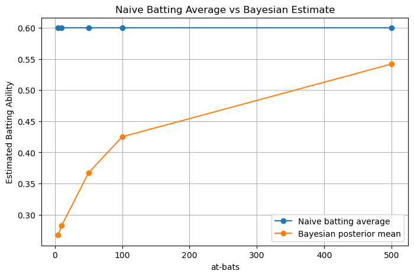
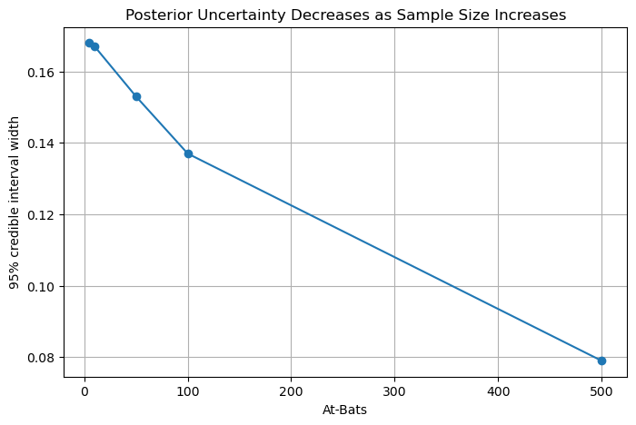
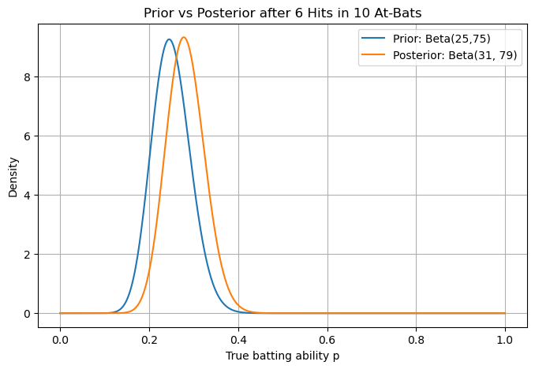

# Bayesian Batting Average Estimation

A small Python statistics project exploring how Bayesian estimation can be used to evaluate baseball batting average in small samples.

Traditional batting average is calculated as:

```text
hits / at-bats
```

This is simple and useful, but it ignores sample size. A player going 6-for-10 and a player going 300-for-500 both have a batting average of `.600`, even though the second case is much stronger evidence of true hitting ability.

This project uses a beta-binomial Bayesian model to produce a more cautious estimate of batting ability by combining observed performance with a prior expectation.

## Project Idea

The model treats a player's true batting ability as an unknown probability, `p`, where:

```text
p = probability of getting a hit in an at-bat
```

A prior distribution is used to represent existing belief about a typical hitter:

```text
p ~ Beta(25, 75)
```

This prior is centred around `.250` and behaves like 100 prior pseudo-at-bats.

When new batting data is observed, the model updates the prior using:

```text
p | h, n ~ Beta(alpha + h, beta + n - h)
```

where:

- `h` = observed hits
- `n` = observed at-bats
- `n - h` = observed outs

The posterior mean is then used as a single-number Bayesian estimate of batting ability.

## What This Shows

The project compares several batting lines which all have the same naive batting average of `.600`:

| Hits | At-Bats | Naive Average |
|---:|---:|---:|
| 3 | 5 | .600 |
| 6 | 10 | .600 |
| 30 | 50 | .600 |
| 60 | 100 | .600 |
| 300 | 500 | .600 |

Although the naive average is identical in every case, the Bayesian estimate changes with sample size. Small samples are pulled strongly toward the prior, while larger samples move closer to the observed average.

This effect is known as **shrinkage**.

## Example Results

With a `Beta(25, 75)` prior:

| Hits | At-Bats | Naive Average | Posterior Mean |
|---:|---:|---:|---:|
| 3 | 5 | .600 | .267 |
| 6 | 10 | .600 | .282 |
| 30 | 50 | .600 | .367 |
| 60 | 100 | .600 | .425 |
| 300 | 500 | .600 | .542 |

The model also calculates 95% credible intervals to represent uncertainty. As sample size increases, the credible interval becomes narrower.

## Figures

### Naive Average vs Bayesian Estimate



### Posterior Uncertainty



### Prior vs Posterior Example



## Repository Structure

```text
bayesian-batting-average/
├── README.md
├── requirements.txt
├── src/
│   └── bayesian_batting.py
├── notebooks/
│   └── 01_basic_beta_binomial.ipynb
├── figures/
│   ├── naive_vs_bayesian_estimate.png
│   ├── posterior_uncertainty_decreases_as_sample_size_increases.png
│   └── prior_vs_posterior_average_example.png
└── paper/
    └── Bayesian_Batting_Average_Estimation.pdf
```

## Running the Project

Clone the repository:

```bash
git clone https://github.com/Matthew-Dobson/bayesian-batting-average.git
cd bayesian-batting-average
```

Install dependencies:

```bash
pip install -r requirements.txt
```

Open the notebook:

```bash
jupyter notebook notebooks/01_basic_beta_binomial.ipynb
```

Then restart the kernel and run all cells.

## Paper

A short write-up explaining the model, assumptions, results, limitations, and future work is available here:

[Bayesian Batting Average Estimation](paper/Bayesian_Batting_Average_Estimation.pdf)

## Limitations

This is a simple demonstration model, not a complete player projection system. It assumes:

- at-bats are independent
- the same prior is appropriate for all examples
- pitcher quality, league quality, park factors, injuries, and tactical role are not modelled
- batting average is the only offensive statistic considered

Future work could test different priors, use real player data, extend the method to OBP/SLG/wOBA, and compare Bayesian estimates with future performance.

## Technologies Used

- Python
- NumPy
- pandas
- SciPy
- Matplotlib
- Jupyter Notebook
